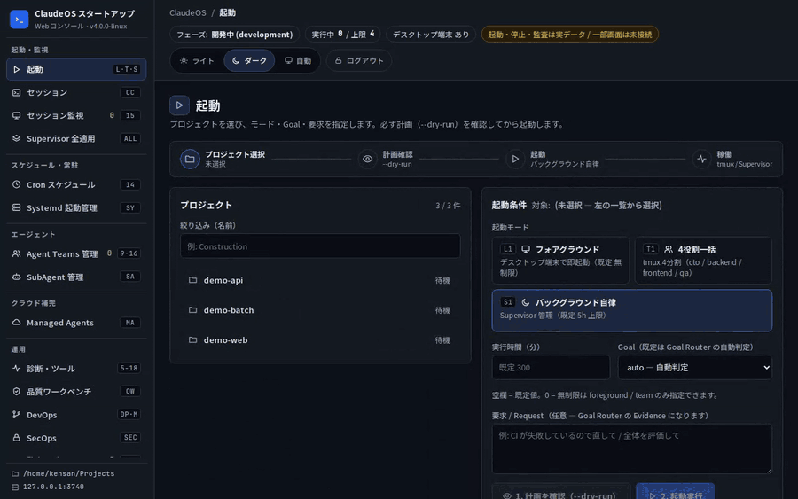
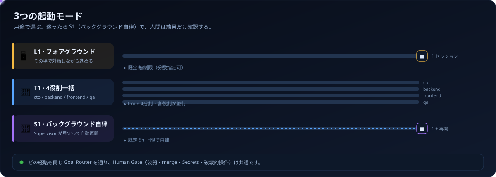
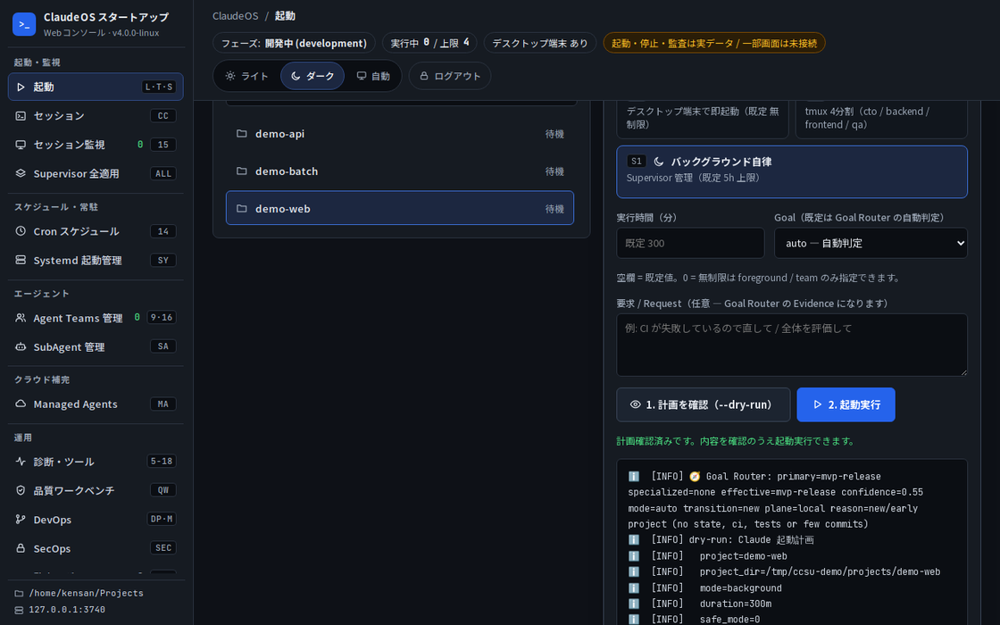
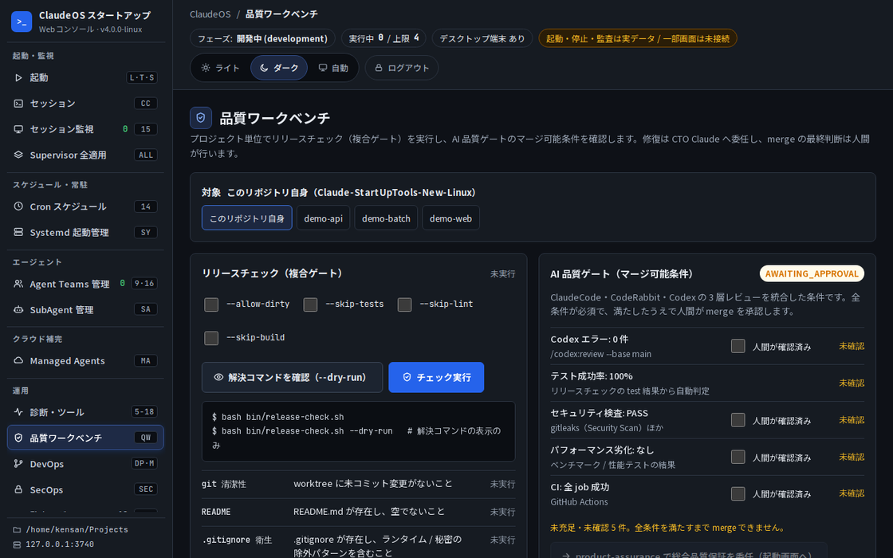
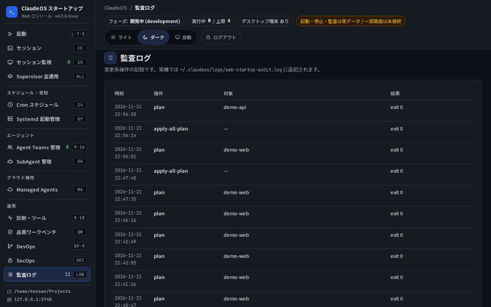
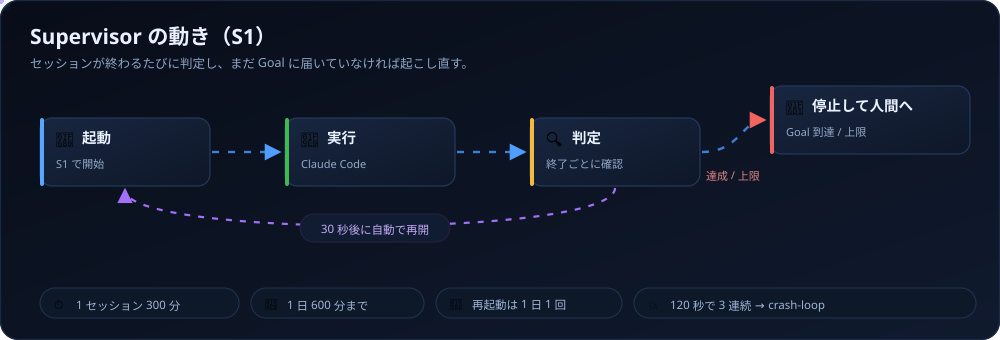

# 🚀 ClaudeOS — Claude-StartUpTools-New-Linux

**Linux 1 台で「AI 開発者に開発を任せる」ための管制塔です。**
プロジェクトを選んで、計画を見て、任せる。人間は最後の判断（公開・merge）だけを持つ。
SSH も Windows も PowerShell も使わない、Linux ローカル専用のツールです。

<p align="center">
  <a href="https://github.com/Kensan196948G/Claude-StartUpTools-New-Linux/actions/workflows/ci.yml">
    
  </a>
  <a href="CHANGELOG.md">
    
  </a>
  
  
  <a href="LICENSE">
    
  </a>
</p>

<p align="center">
  
</p>

<p align="center">
  🎬 <b>30 秒デモ</b><br>
  <a href="docs/assets/demo/claudeos-demo.mp4">▶️ MP4 で再生（音声なし）</a> ·
  <a href="#-画面ギャラリーweb-コンソール">🖼️ 画面ギャラリー</a> ·
  <a href="#-3ステップではじめる">⚡ すぐ始める</a>
</p>

---

## 🧭 30秒でわかる ClaudeOS

| | 質問 | 答え |
|---|---|---|
| 🎯 | 何をするツール？ | Claude Code（AI 開発者）を、選んだプロジェクトで起動し、**止まっても自動で再開**させ、記録を残す |
| 🧍 | だれが使う？ | Linux を自分で触れる人。エンジニア 1 人でも複数プロジェクトを回したい人 |
| 🐧 | どこで動く？ | Linux ローカルのみ。`tmux`・`cron`・`systemd`・`claude` を使う。SSH / Windows 経路は持たない |
| ⚡ | どう始める？ | `cp config/config.json.template config/config.json` → `./start.sh` → 番号を選ぶ（3 ステップ） |
| 🔁 | 放置できる？ | できる。`S1` は Supervisor 管理で、Goal 到達・Blocked・上限まで自動で再開（既定 5 時間 / 再起動は 1 日 1 回まで） |
| ✋ | 何は人が決める？ | 本番公開・merge / main 直 push・Secrets・課金・破壊的削除・全適用の最終実行（Human Gate） |
| 🧪 | 品質は？ | Bats 56 ファイル + Node 19 ファイルのテスト、shellcheck、GitHub Actions、E2E、敵対プローブ、TLA+ |

> 🏢 **たとえるなら**: ClaudeOS は「AI 開発者のための管制塔」です。
> 管制塔（ClaudeOS）が作業部屋（`tmux`）と見張り役（Supervisor）を用意し、パイロット（Claude Code）が飛びます。
> 離陸（起動）と航路（計画）は管制塔が用意しますが、着陸の許可（公開・merge）は人間が出します。

### 📚 目次

- [🎬 30秒デモの見どころ](#-30秒デモの見どころ)
- [🧭 全体アーキテクチャ](#-全体アーキテクチャ)
- [🚀 3ステップではじめる](#-3ステップではじめる)
- [🎛️ 3つの起動モード](#-3つの起動モード)
- [📺 画面ギャラリー（Web コンソール）](#-画面ギャラリーweb-コンソール)
- [🔁 自律運転のしくみ](#-自律運転のしくみ)
- [✋ 人間が決めること（Human Gate）](#-人間が決めることhuman-gate)
- [🧪 検証（実測値）](#-検証実測値)
- [📊 バージョンと統計](#-バージョンと統計)
- [📚 用語集](#-用語集)
- [❓ FAQ](#-faq)

---

## ✨ できること

| アイコン | 機能 | かんたんな説明 |
|---|---|---|
| 🐧 | Linux ネイティブ | ローカルの `claude` / `tmux` / `cron` / `systemd` をそのまま使う |
| 📂 | プロジェクト検出 | 設定したフォルダ配下の Git リポジトリを起動候補として自動で並べる |
| 🖥️ | 3 つの起動モード | `L1` その場で対話 / `T1` 4 役割を並行 / `S1` バックグラウンド自律 |
| 🧩 | Supervisor | Goal 到達・Blocked・上限まで、止まったセッションを自動で再開 |
| 🎯 | Goal Router | 「今日は何の開発か」を状態と要求から自動判定し、`/goal` を注入 |
| 📺 | セッション監視 | 実行中のセッション、経過時間、残り時間を一覧表示 |
| 🌐 | Web コンソール | 同じ操作をブラウザから。14 画面・実データ表示・全操作を監査ログに記録 |
| 🔔 | Heartbeat Watchdog | API エラー・入力待ち・強制終了（SIGKILL/OOM）の 3 類型を検知して通知 |
| 🧪 | 品質ゲート | リリースチェック（git/README/test/lint/build）+ AI 品質ゲートで公開前に確認 |
| ✋ | Human Gate | 公開・merge・Secrets・課金・破壊的操作は、必ず人の確認を挟む |

---

## 🎬 30秒デモの見どころ

上のアニメーションは、**隔離したデモ環境**（`demo-web` / `demo-api` / `demo-batch` の 3 プロジェクト）で撮影した実際の操作です。
ポインタは矢印で表示し、押した場所には波紋が出ます。

| 秒 | 画面 | 起きていること |
|---|---|---|
| 0–2.5 | 🚀 起動 | プロジェクトを選ぶ（`demo-web` にチェックが付く） |
| 2.5–5 | 🎮 起動モード | `L1` / `T1` / `S1` の違いを確認して `S1` を選ぶ |
| 5–13 | 👁️ 計画確認 | `--dry-run` で「Goal Router の判定」と「起動計画」を表示。まだ何も起動しない |
| 13–19 | 🔧 診断・ツール | 「ツール確認・診断」をその場で実行し、検出結果が並ぶ |
| 19–23 | 🧪 品質ワークベンチ | リリースチェックと AI 品質ゲート（未充足は「未確定」と表示） |
| 23–27 | 📋 監査ログ | `plan demo-web exit 0` など、変更系の操作が自動で記録される |
| 27–30 | 🎬 クロージング | 「選ぶ・確認する・任せる」で締め |

---

## 🧭 全体アーキテクチャ

<p align="center">
  
</p>

- **入口は 2 つ**: ターミナルのメニュー（`./start.sh`）と Web コンソール（ブラウザ）。どちらも同じ CLI を呼ぶだけの薄い層です。
- **自動で回る部分**: 起動・監視・再開・Goal 判定・検証。`Supervisor` がセッションを見張り、必要なら起こし直します。
- **人が持つ部分**: 公開・merge・Secrets・課金・破壊的削除。ここだけは自動化しません（Human Gate）。

---

## 🚀 3ステップではじめる

| # | やること | コマンド | 何が起きる |
|---|---|---|---|
| 1 | 設定を作る | `cp config/config.json.template config/config.json` | プロジェクトのルートなど自分の環境に合わせる |
| 2 | メニューを開く | `./start.sh` | 番号で選ぶ運用メニューが起動する |
| 3 | 番号を選ぶ | `L1` / `T1` / `S1` | Claude Code が起動する（`S1` は Supervisor 管理） |

```bash
cp config/config.json.template config/config.json
./start.sh
```

起動すると、次のようなメニューが出ます（`15` がセッション監視、`14` が cron）。

```text
  ╔════════════════════════════════════════════════════╗
  ║  🤖 ClaudeCode スタートアップツール v4.0.0-linux ║
  ╚════════════════════════════════════════════════════╝
  📋 フェーズ: 開発中 (development)
  📂 /home/<you>/Projects

  🚀 起動
    L1   🖥️  ローカル即起動 (フォアグラウンド / 無制限)
    T1   👥 4役割一括起動 (tmux 4分割 / cto+backend+frontend+qa)
    S1   🌙 バックグラウンド起動 (自律 / 5h)
```

この下に、診断・ツール（`5`〜`18`）・Systemd 起動管理（`SY`）・Managed Agents（`MA`）・Cron 管理（`14` / `15`）・終了（`0`）が続きます。

実行中のセッションは、メニューの `15` か次のコマンドで確認できます。

```bash
bash libexec/watch-session.sh                    # 一覧・経過・残り時間
tmux attach -t claudeos-<project>               # 中に入る（Ctrl-b d でデタッチ＝バックグラウンド継続）
```

> ⚠️ 最初は `S1` ではなく `L1` で 1 回動かしてみるのがおすすめです。
> 動きを目で確認してから、`S1` + Supervisor で任せる運用に切り替えると安全です。

---

## 🎮 3つの起動モード

<p align="center">
  
</p>

| モード | アイコン | 向いている場面 | 既定 | 中に入る方法 |
|---|---|---|---|---|
| `L1` | 🖥️ | その場で対話しながら進めたい | 無制限（分数指定可） | 起動した端末をそのまま使う |
| `T1` | 👥 | cto / backend / frontend / qa を並行で動かしたい | tmux 4 分割 | `tmux attach -t claudeos-<project>` |
| `S1` | 🌙 | 寝ている間に進めたい・放置したい | 5 時間（設定変更可） | `tmux attach` か Web コンソール |

- `S1` は Supervisor 管理なので、**止まっても自動で再開**します（再起動は既定で 1 日 1 回まで）。人間は結果だけ確認すれば十分です。
- どのモードも Goal Router を通り、Human Gate は共通です。

### 🚢 Ship Native モード（v5.0 / Experimental）

Claude Code の `/ship`（PR 作成 → `/code-review` → 修正の watch）を開発ライフサイクルに組み込みます。
`/ship` は公式仕様で **人が対話セッションに入力したときだけ** 起動するため（`claude -p` では起動しない）、ClaudeOS は入力を代行せず、前後の工程を担います。

| モード | 内容 | 状態の表示 |
|---|---|---|
| `SH1` | 現在のブランチ / PR に `/ship` で品質検証（手順を表示） | `bash bin/ship-mode.sh status` |
| `SH2` | Ship Native 自律開発（run 作成 → 対話セッション起動） | 同上 |
| `SH3` | Agent Teams + Ship | 同上 |
| `SH4` | 既存 PR 改善（`/steward`） | 同上 |
| `SH5` | 複数プロジェクトの run / PR 監視 | 同上 |
| `QC` | Ubuntu ローカル品質検証（bwrap 隔離・証跡封印） | `bash bin/ship.sh quality ...` |
| `HG` | Human Gate（承認は人の端末から `bin/ship-approve.sh`） | — |

人間の最終承認は **パスフレーズ保護の署名** で head / base SHA に固定され、コードが 1 コミットでも変われば無効になります。
自動マージは、中央 GitHub ポリシーの施行と ruleset 変更（人間承認事項）が済むまで登録されません。
詳細: [アーキテクチャ](docs/architecture/SHIP_NATIVE_ARCHITECTURE.md) / [運用手順](docs/architecture/SHIP_OPERATIONS_RUNBOOK.md) / [セキュリティ](docs/architecture/SHIP_SECURITY_MODEL.md) / [ポリシー変更案](docs/architecture/SHIP_POLICY_MIGRATION.md)

---

## 📺 画面ギャラリー（Web コンソール）

同じ起動・監視・診断・品質確認をブラウザから行えます（全 14 画面、表示は実データ）。

| 画面 | できること | 状態 | 画像 |
|---|---|---|---|
| 🚀 起動 | プロジェクト選択 → 計画（`--dry-run`）→ 起動 | ✅ 実データ | [見る](docs/assets/screens/01-start.png) |
| 💬 セッション | 実行中セッションを選んでプロンプトを送る画面 | — | — |
| 📺 セッション監視 | 稼働状況・経過・残り時間の一覧、停止 | ✅ 実データ | [見る](docs/assets/screens/02-sessions.png) |
| 🧩 Supervisor 全適用 | 対象と skip 理由の**計画のみ**（実行は CLI で人間が行う） | ✅ 計画のみ | [見る](docs/assets/screens/03-apply-all.png) |
| ⏰ Cron / 🧩 Systemd | crontab・unit の状態表示 | 👁️ 読み取り専用 | — |
| 🤝 Agent Teams / 🧬 SubAgent | 利用状況・カタログ KPI | 👁️ 読み取り専用 | — |
| ☁️ Managed Agents | roster・当月使用量（未設定なら「未設定」） | 👁️ 読み取り専用 | — |
| 🔧 診断・ツール | allowlist の診断 9 本をその場で実行（ほかは「未接続」表示） | ✅ 実行可 | [見る](docs/assets/screens/04-tools.png) |
| 🧪 品質ワークベンチ | リリースチェック + AI 品質ゲート | ✅ ジョブ実行 | [見る](docs/assets/screens/05-quality.png) |
| 🛠️ DevOps / 🛡️ SecOps | git HEAD・timer・DB 数 / ツール有無 | 👁️ 読み取り専用 | — |
| 📋 監査ログ | 変更系操作の履歴（`~/.claudeos/logs/web-startup-audit.log`） | ✅ 実データ | [見る](docs/assets/screens/06-audit.png) |

<p align="center">
  <br>
  <sub>🚀 起動 — 選ぶ → 計画を見る → 実行する（計画の出力がそのまま下に表示される）</sub>
</p>

<p align="center">
  <br>
  <sub>🧪 品質ワークベンチ — 充足していない項目は「未確定」と明示される</sub>
</p>

<p align="center">
  <br>
  <sub>📋 監査ログ — 誰が何をしたかが残る（変更系の操作はここで追える）</sub>
</p>

> 🖼️ そのほかの画面は [`docs/assets/screens/`](docs/assets/screens/) にあります。
> 撮影方法・再現手順は [`docs/assets/README.md`](docs/assets/README.md)、
> 起動方法と API の詳細は [`docs/architecture/WEB_CONSOLE_V2.md`](docs/architecture/WEB_CONSOLE_V2.md) を参照してください。

<details>
<summary>🖥️ コンソールの起動・停止・常駐（クリックで展開）</summary>

```bash
bash bin/web-startup.sh --start            # 起動（既定 http://127.0.0.1:3740）
bash bin/web-startup.sh --status           # 状態
bash bin/web-startup.sh --stop             # 停止
npm run start:web:dry                      # 計画専用モード（実起動しない）
bash bin/web-startup-service.sh --register # systemd --user で常駐（bind は loopback のまま）
```

Web サーバは TTY を持たないため `foreground`（`L1`）は選べません（`T1` / `S1` は常に利用可）。
変更系の操作は `~/.claudeos/logs/web-startup-audit.log` に記録されます。

</details>

<details>
<summary>🎨 表示ポリシー（色の意味）</summary>

運用メニューとセッション監視は、灰色表示を使いません。

| 用途 | 色 |
|---|---|
| 見出し・罫線 | 🟦 シアン |
| 正常・稼働 | 🟩 緑 |
| 選択・注意 | 🟨 黄 |
| 異常・停止 | 🟥 赤 |
| 補助カテゴリ | 🟪 マゼンタ |

</details>

---

## 🔁 自律運転のしくみ

### 🎯 Goal Router — 「今日は何の開発か」を自動で決める

起動経路（`L1` / `T1` / `S1` / cron / headless / Supervisor）は、すべて同じ `lib/goal-router.sh` の判定を通ります。
Project 状態 + Repository の証拠 + ユーザーの要求 から、Primary Goal → Specialized Goal を決めて `/goal` を注入します。

| Primary Goal | 用途 | Specialized（配下） |
|---|---|---|
| `development` | 既存プロジェクトの通常開発・継続改善 | refactoring / hotfix |
| `mvp-release` | 新規 / Prototype / PoC / MVP | production-release |
| `assessment` | 評価・Readiness・Architecture / Security Review | security-emergency |
| `deep-debug` | CI 失敗・Runtime Error・Regression の根本原因解析 | hotfix / security-emergency |
| `product-assurance` | リリース前の総合品質保証（DB・Security・Contract・E2E・性能・A11y） | production-release / safe-auto-merge / pr-babysit |

| 操作 | 方法 |
|---|---|
| 自動判定（既定） | `state.json` の `goal_router.mode=auto` |
| 手動で固定 | `bin/start-claude.sh --project P --foreground --goal deep-debug`（`--goal auto` で解除） |
| 要求を渡す | `--intent "全体を評価して"`（Evidence として扱われる） |
| 判定だけ見る | `bash libexec/goal-router.sh <project> --dry-run [--json] [--explain]` |
| 無効化 | `CLAUDEOS_GOAL_ROUTER_DISABLE=1` で従来の `goal_type` に戻る |

### 🧩 Supervisor — 止まっても自分で再開する

<p align="center">
  
</p>

| ガードレール | 既定値 | 意味 |
|---|---|---|
| ⏱️ 1 セッション | 300 分（5 時間） | 1 回の自律実行の長さ |
| 📅 1 日の合計 | 600 分（10 時間） | 使いすぎを防ぐ上限 |
| 🔁 再起動 | 1 日 1 回 | 止まったときの起こし直し回数 |
| ⏳ クールダウン | 30 秒 | 再起動の前に待つ時間 |
| 💥 crash-loop 判定 | 120 秒以内に 3 連続 | 壊れ続けるときは止めて人間へ |

全プロジェクトへ一括適用するときは、**必ず計画から**実行します（安全のため、既定で次は skip されます）。

```bash
bash bin/autonomy.sh start --all --dry-run    # 対象と skip 理由を確認
bash bin/autonomy.sh start --all --yes        # 人間が確認したあとに実行
```

| アイコン | skip される対象 |
|---|---|
| 🔁 | すでに Supervisor が稼働中のプロジェクト |
| ⏰ | cron 登録が残っているプロジェクト |
| 🧰 | このランチャー自身 |

### 🔔 Heartbeat Watchdog — 沈黙を 3 種類に分けて検知する

| 種別 | 原因 | 担当フック | 通知イベント |
|---|---|---|---|
| type1 | API エラー・ツール失敗 | `stop-failure-gate.js` | `api_failure` |
| type2 | 入力待ちで止まっている | `notification-gate.js` | `input_waiting` |
| type3 | SIGKILL / OOM / 再起動 | `heartbeat-watchdog.js` | `api_failure` |

<details>
<summary>🔧 type3（Heartbeat Watchdog）の有効化手順を見る</summary>

`state.json` に webhook を設定し、環境変数と cron を用意します。

```json
{
  "webhook": {
    "enabled": true,
    "events": { "api_failure": true }
  }
}
```

```bash
export TEAMS_WEBHOOK_URL="https://xxxxx.webhook.office.com/webhookb2/..."
# または
export HTTPS_WEBHOOK_URL="https://your-endpoint.example.com/webhook"
```

```bash
mkdir -p ~/.claudeos/logs
# crontab -e で追加（5 分ごとに監視）
*/5 * * * * cd /home/<you>/Projects/YOUR_PROJECT && \
  TEAMS_WEBHOOK_URL="$TEAMS_WEBHOOK_URL" \
  node .claude/claudeos/scripts/hooks/heartbeat-watchdog.js \
  >> ~/.claudeos/logs/heartbeat-watchdog-YOUR_PROJECT.log 2>&1
```

詳しい手順: [`docs/claude/08_heartbeat-watchdog-cron設定手順.md`](docs/claude/08_heartbeat-watchdog-cron設定手順.md)

</details>

---

## ✋ 人間が決めること（Human Gate）

| 区分 | 内容 |
|---|---|
| ✅ 自律で進めてよい | 調査・実装・テスト・文書更新・PR 準備・診断・修正の試行 |
| ✋ 人が確認してから | 🚀 本番公開 ／ 🔀 merge・main 直 push ／ 🔐 Secrets ／ 💳 課金 ／ 🗑️ 破壊的削除 ／ 🌐 Supervisor 全適用の最終実行 |

- Web コンソールでも、起動は「計画（`--dry-run`）→ 確認 → 実行」の順番が固定です。
- 変更系の操作は `~/.claudeos/logs/web-startup-audit.log` に記録されます。
- Git 運用は中央ポリシー（`GITHUB_POLICY.md`）に従います: main 直 push 禁止・Required Checks PASS 後に Squash Merge・merge 後に branch 削除。

---

## 🧠 ClaudeOS v10 / v11（上級者向け）

<details>
<summary>🧬 v10 — Native-Agentic Development OS の実装（クリックで展開）</summary>

原則は **Claude Code Native 機能 > Thin ClaudeOS Adapter > Custom Implementation**。
ClaudeOS は AI 機能を再実装せず、Linux 上で安全・長時間・複数プロジェクトで運用する Control Plane に徹します。

| 領域 | 実装 | 入口 |
|---|---|---|
| 🧪 互換性 / Capability Detection | `config/claude-code-compat.json`（minimum 2.1.224 / tested 2.1.263） | メニュー `17`、`bash libexec/diag-claude-compat.sh --json` |
| 🐘 Local PostgreSQL 正本 | `lib/postgres.sh`、`bin/pg-ops.sh`（init / backup / verify / restore-drill / freshness など） | メニュー `18`、`bin/pg-ops.sh status --json` |
| 🤖 Lazy Agent Architecture | `config/agent-catalog.json`、`scripts/tools/agent-router.js` | `/agent-router` |
| 🧠 Context Engineering | `CLAUDE.md` + `.claude/rules/`（path-scoped）+ skill 8 本 | `/doctor`、`/skill-doctor` |
| 🔧 Hooks / 権限 | `${CLAUDE_PROJECT_DIR}` 絶対パス、Stop async、deny 強化 | `node --test scripts/hooks-settings.test.js` |
| 🔁 Self-Improvement / SDLC | `/improver`、`/sdlc-scale`、`tests/evals/` | `docs/architecture/SELF_IMPROVEMENT_ARCHITECTURE.md` |
| 🎛️ Mission Control | v10 Platform パネル（PostgreSQL / Capability / routing / hooks） | `/api/v10` |

設計・移行記録: [`ARCHITECTURE_V10.md`](docs/architecture/ARCHITECTURE_V10.md) / [`MIGRATION_V9_TO_V10.md`](docs/architecture/MIGRATION_V9_TO_V10.md)

</details>

<details>
<summary>🚧 v11 — Managed-Agent Native Architecture（進行中）</summary>

Claude Managed Agents を **Autonomous Execution Plane** とする移行を、P0（実行基盤）から段階的に進めています。

| 領域 | 実装 | 入口 |
|---|---|---|
| 🏗️ 実行設定契約 | `config/managed-agents.json.template`（`enabled` / `mode=disabled\|dry-run\|live` / budget 契約） | テンプレートを `config/managed-agents.json` にコピー |
| 💰 budget 必須化 | `scripts/tools/managed-session-payload.js` — budget 無しは `BUDGET_REQUIRED` で拒否 | `node scripts/tools/managed-session-payload.js session-create --config ...` |
| 🧭 実行 Plane 選択 | Goal Router が `execution_plane=managed\|local` を判定。契約不成立時は **fail-safe で local** | `lib/goal-router.sh`、`bin/start-claude.sh` |
| 📝 監査 / 状況 | P0 監査（crash 前提再評価・live 検証 Blocker・rollback 手順） | [`audits/2026-09-09-managed-agents-v11-p0.md`](docs/architecture/audits/2026-09-09-managed-agents-v11-p0.md) |

**Managed Agents 統合（read-only PoC）**: Local Claude Code を主系のまま、読取専用タスクのクラウド補完先として使えます。

| 領域 | 実装 | 入口 |
|---|---|---|
| 🔌 Adapter | `scripts/tools/managed-agents.js`（依存ゼロ） | `bin/managed-agents.sh status` |
| 💰 Budget Guard・台帳 | `scripts/tools/managed-budget.js`（70 / 85 / 95 / 100% の段階制御） | `bin/managed-agents.sh budget status` |
| 🧭 Agent Router 統合 | `managed` ブロックによる opt-in 判定 | `bin/managed-agents.sh route --json '<task>'` |
| 🤖 初期 Agent | Repository Review / Quality Assurance / Documentation | `config/managed-agents-roster.json` |

- 配布時は `enabled=false` / `mode=disabled`。設定しない限り既存の動作は変わりません。
- 歯止め: 1 日 5 回・1 回 $2・月 $20。Claude Code / Agent SDK の予算（`lib/credits.sh`）とは別管理です。
- live の初回接続テストは **成功**（2026-10-10、$0.05）。異常系は実 API では未検証で、PoC は MCP を使わない構成にしています。

設計: [`MANAGED_AGENTS_INTEGRATION.md`](docs/architecture/MANAGED_AGENTS_INTEGRATION.md) ／
運用: [`docs/claude/21_ManagedAgents統合運用手順.md`](docs/claude/21_ManagedAgents統合運用手順.md)

</details>

---

## 🌐 外部公開（Cloudflare Tunnel + Access）

<details>
<summary>🔐 公開構成と制約（クリックで展開）</summary>

- 入口: `https://claude-startuptools.mirai-dx-platform.com`（Cloudflare Access ログイン必須。許可は 1 メールのみ、他は deny）。
- 公開ルートは **ClaudeOS Console WebUI**（systemd --user `claude-startuptools-webui.service` / `127.0.0.1:4612`）。
- `/terminal` は ttyd（`127.0.0.1:3741`）。ブラウザ内で実端末が動き、既存 `claudeos-*` セッションへ接続できます。
- このリポジトリの Node コンソール（`127.0.0.1:3740`）は loopback 運用のまま残しています。
- Web サーバは TTY を持たないため、**`foreground`（L1）はデスクトップ端末がある環境でのみ選択可**です（`T1` / `S1` は常に利用可）。

手順・read-back: [`WEB_STARTUP_PUBLIC_ACCESS.md`](docs/architecture/WEB_STARTUP_PUBLIC_ACCESS.md) ／
端末: [`WEB_TERMINAL.md`](docs/architecture/WEB_TERMINAL.md) ／
設定: `config/cloudflare/web-startup-{tunnel.yml,access-policy.json}`

</details>

---

## 🧪 検証（実測値）

この README の数字は、このリポジトリで実行した結果です（2026-11-22 時点）。

| アイコン | コマンド | 確認内容 | 実測結果 |
|---|---|---|---|
| 🧪 | `npm test` | Bats 56 ファイル + Node 19 ファイル | ✅ **1418 件 PASS**（Bats 1048 / Node 370） |
| 🧹 | `npm run lint` | shellcheck（`-S error`） | ✅ PASS |
| 🌐 | `bash bin/autonomy.sh start --all --dry-run` | 全適用の対象と skip 理由 | ✅ 対象 3 件 / skip 0 件（デモ環境） |
| 🛡️ | `bash bin/adversarial-probe.sh run --json` | エージェントポリシーの攻撃耐性 | ✅ 18 件 / 失敗 0 |
| 🧮 | `bash bin/policy-check.sh matrix --json` | deny-by-default の判定分布 | ✅ 198 判定 |
| 📐 | `bash scripts/tools/tla-check.sh run --json` | run-ledger 状態機械の TLA+ モデル検査 | ✅ verified（146 状態 / 60 到達可能） |
| 🖥️ | `node scripts/e2e/console.e2e.js` | 統合コンソールを実ブラウザで検証 | ✅ CI の `e2e-console` ジョブ |

CI は GitHub Actions の 2 ジョブ（`linux-validate` = テスト + lint + 敵対プローブ + TLA+、`e2e-console` = 実ブラウザ検証）で回ります。
セキュリティスキャン（gitleaks）は [`security-scan.yml`](.github/workflows/security-scan.yml) です。

---

## 📊 バージョンと統計

| 項目 | 値 |
|---|---|
| バージョン | **4.0.0-linux** |
| Agents | **44体** |
| ClaudeOS カーネル | **44体+46コマンド** |
| 主要スクリプト | `bin/` 33 本 / `lib/` 28 本 / `libexec/` 17 本 |
| テスト | Bats 56 ファイル（1048 件）/ Node 19 ファイル（370 件） |
| 画面 | Web コンソール 14 画面 + ターミナルメニュー |

---

## 📚 用語集

| 用語 | かんたんに言うと |
|---|---|
| 🤖 Claude Code | AI 開発者。実装・テスト・PR を作る本体 |
| 🖥️ tmux | 画面を閉じても動き続ける仮想端末。セッションの「作業部屋」 |
| 🧩 Supervisor | 見張り役。止まったセッションを起こし直す |
| 🎯 Goal Router | 「今日は何の開発か」を自動で決める係 |
| ✋ Human Gate | 人が最後に押すボタン（公開・merge など） |
| 📦 プロジェクト | 起動対象の Git リポジトリ（設定フォルダ直下など） |
| 📝 監査ログ | 誰が何をしたかの記録。`~/.claudeos/logs/` 配下 |

---

## 📁 ディレクトリ構成

| パス | 役割 |
|---|---|
| 🚀 `bin/` | 起動・停止・監視・Supervisor・cron・診断などの CLI（33 本） |
| 🧩 `lib/` | 共通関数（設定・JSON・tmux・Supervisor・Goal Router）（28 本） |
| 🛠️ `libexec/` | 診断・補助の実行スクリプト（17 本） |
| ⚙️ `config/` | 設定テンプレート（`config.json.template` など） |
| 🧠 `Claude/templates/` | 各プロジェクトへ配布する Claude 指示・ClaudeOS カーネル・Linux テンプレート |
| 🧪 `tests/` | Bats（56）と golden eval |
| 📚 `docs/` | アーキテクチャ・運用文書（下の索引を参照） |
| 🖼️ `docs/assets/` | README 用の図・スクリーンショット・デモ動画 |
| 🐙 `.github/workflows/` | CI（linux-validate / e2e-console）とセキュリティスキャン |

---

## 📖 ドキュメント索引

| 目的 | ドキュメント |
|---|---|
| 📘 全体像・運用モデル | [`CURRENT_ARCHITECTURE.md`](docs/architecture/CURRENT_ARCHITECTURE.md) / [`OPERATIONS_MODEL.md`](docs/architecture/OPERATIONS_MODEL.md) |
| 🎯 Goal Router の設計 | [`GOAL_ROUTER.md`](docs/architecture/GOAL_ROUTER.md) / [`docs/claude/20_統合GoalRouter.md`](docs/claude/20_統合GoalRouter.md) |
| 🌐 Web コンソール | [`WEB_CONSOLE_V2.md`](docs/architecture/WEB_CONSOLE_V2.md) / [`WEB_STARTUP_TOOL.md`](docs/architecture/WEB_STARTUP_TOOL.md) |
| 🔐 セキュリティ | [`SECURITY_MODEL.md`](docs/architecture/SECURITY_MODEL.md) / [`SECURITY.md`](SECURITY.md) |
| 🐘 PostgreSQL | [`POSTGRESQL_ARCHITECTURE.md`](docs/architecture/POSTGRESQL_ARCHITECTURE.md) / [`POSTGRESQL_BACKUP_RECOVERY.md`](docs/architecture/POSTGRESQL_BACKUP_RECOVERY.md) |
| ☁️ Managed Agents | [`MANAGED_AGENTS_INTEGRATION.md`](docs/architecture/MANAGED_AGENTS_INTEGRATION.md) / [`docs/claude/21_ManagedAgents統合運用手順.md`](docs/claude/21_ManagedAgents統合運用手順.md) |
| 🧱 Runtime Foundations | [`RUNTIME_FOUNDATIONS.md`](docs/architecture/RUNTIME_FOUNDATIONS.md) |
| 🚀 セットアップ・使い方 | [`docs/claude/02_セットアップ.md`](docs/claude/02_セットアップ.md) / [`docs/claude/03_使い方.md`](docs/claude/03_使い方.md) |
| 🔁 検証ループ | [`docs/claude/18_検証ループ運用.md`](docs/claude/18_検証ループ運用.md) |
| 🧭 編集する場所に迷ったら | [`SOURCE_OF_TRUTH.md`](docs/SOURCE_OF_TRUTH.md) |

---

## ❓ FAQ

<details>
<summary>❔ Claude Code がインストールされていなくても動きますか？</summary>

いいえ。`claude` コマンドが必要です。互換性は `config/claude-code-compat.json`（minimum 2.1.224 / tested 2.1.263）で管理し、
`bash libexec/diag-claude-compat.sh --json` で確認できます。

</details>

<details>
<summary>❔ Windows や SSH 経由でも使えますか？</summary>

対象外です。このリポジトリは Linux ローカル専用で、SSH 接続・Windows 起動経路・PowerShell/Pester・PTY bridge・リモート配布を持ちません。

</details>

<details>
<summary>❔ S1 で起動したあと、どこまで自動で進みますか？</summary>

Goal 到達・Blocked・上限時間まで、Supervisor が自動で再開します（再起動は既定で 1 日 1 回まで）。
公開・merge・Secrets・課金・破壊的削除は自動では行いません（Human Gate）。

</details>

<details>
<summary>❔ 失敗したときはどこを見ればいいですか？</summary>

| 見る場所 | 内容 |
|---|---|
| `~/.claudeos/logs/` | セッションログ・監査ログ・Web コンソールのログ |
| `bash libexec/watch-session.sh` | 実行中セッションの状態 |
| メニュー `15` | セッション監視（経過・残り時間） |
| `bin/incident-response.sh` | P1/P2/P3 のトリアージ |

</details>

<details>
<summary>❔ 課金はどこまで進みますか？</summary>

Claude Code / Agent SDK の予算は `lib/credits.sh` で管理します。Managed Agents は既定で無効（`enabled=false`）で、
有効化しても 1 日 5 回・1 回 $2・月 $20 の歯止めがかかります。

</details>

<details>
<summary>❔ ツールを追加・変更したいときは？</summary>

`docs/SOURCE_OF_TRUTH.md` の分類（Source / Deployed / Generated）に従ってください。
正本は `bin/` `lib/` `libexec/` `Claude/templates/` `docs/architecture/` です。

</details>

---

## 🚫 対象外・既知の制約

| アイコン | 対象外 / 制約 |
|---|---|
| 🔌 | SSH 接続 |
| 🪟 | Windows 起動経路 |
| 📜 | PowerShell / Pester |
| 🌉 | PTY bridge |
| 📤 | リモート配布 |
| 👁️ | Web コンソールの一部画面は読み取り専用（Cron・Systemd・Agent Teams・Managed Agents・DevOps・SecOps） |
| 🌐 | Web コンソールの「Supervisor 全適用」は計画のみ（実行は CLI で人間が行う） |
| 🖥️ | Web からの `L1`（フォアグラウンド）は、デスクトップ端末がある環境のみ |
| ☁️ | Managed Agents の異常系は実 API では未検証 |

---

## 🐙 GitHub / CI / セキュリティ

| 項目 | 内容 |
|---|---|
| リポジトリ | <https://github.com/Kensan196948G/Claude-StartUpTools-New-Linux> |
| CI | [`ci.yml`](.github/workflows/ci.yml)（linux-validate / e2e-console） |
| セキュリティ | [`security-scan.yml`](.github/workflows/security-scan.yml)、gitleaks、[`SECURITY.md`](SECURITY.md) |
| 変更履歴 | [`CHANGELOG.md`](CHANGELOG.md) |
| 開発ルール | [`AGENTS.md`](AGENTS.md)、[`GITHUB_POLICY.md`](GITHUB_POLICY.md) |

---

## 📄 ライセンス

[MIT](LICENSE)。ただし、本番公開・merge・Secrets・課金・破壊的削除は、必ず人間が確認してから実行してください。
